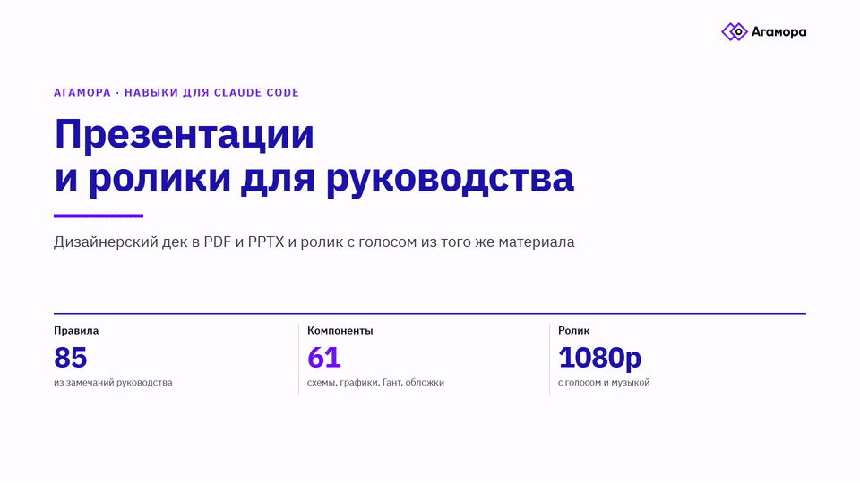
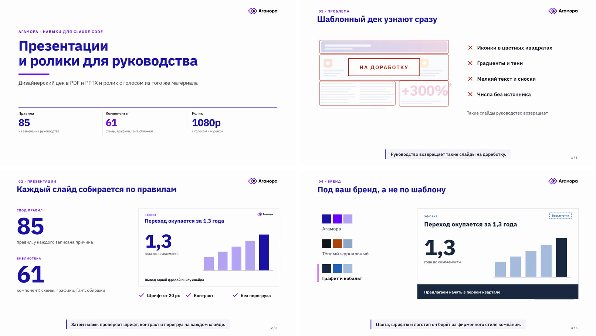
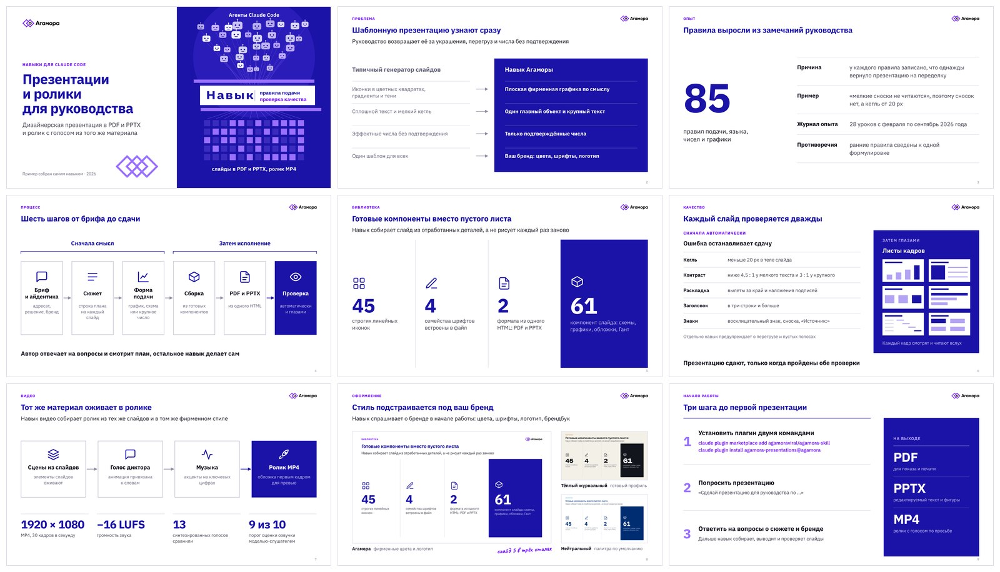
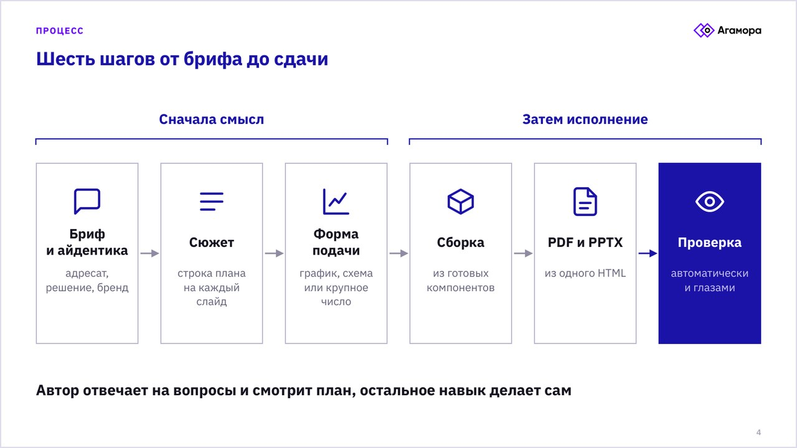
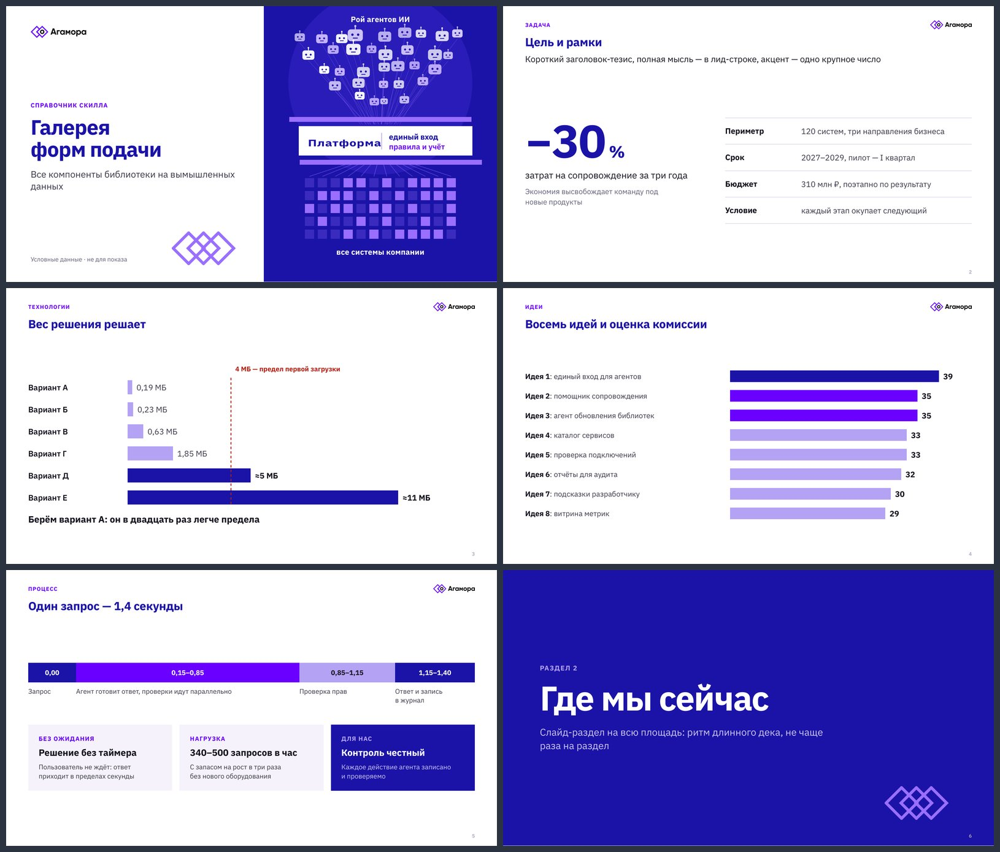
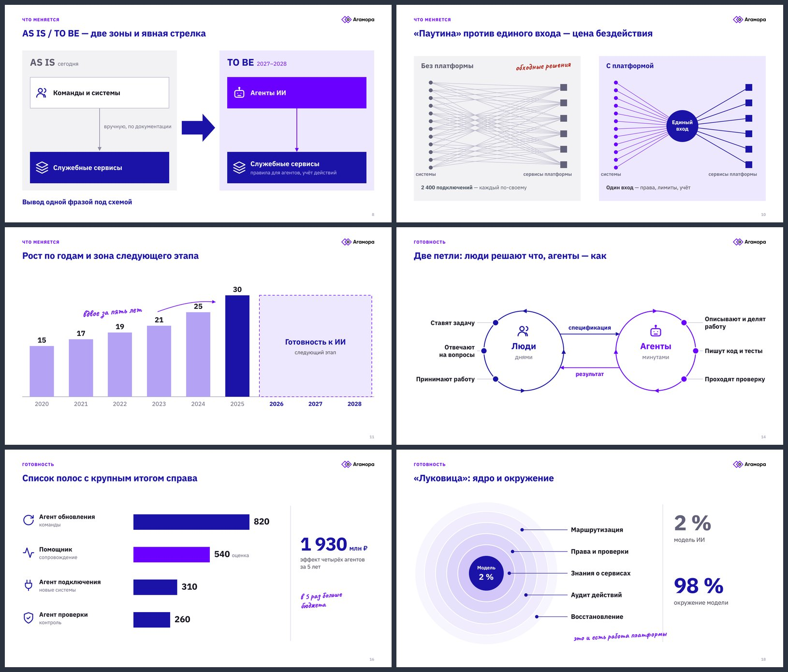
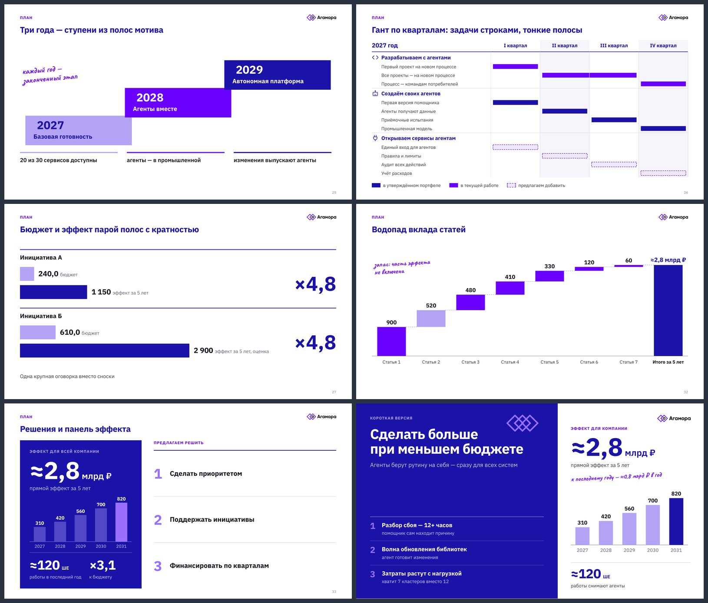
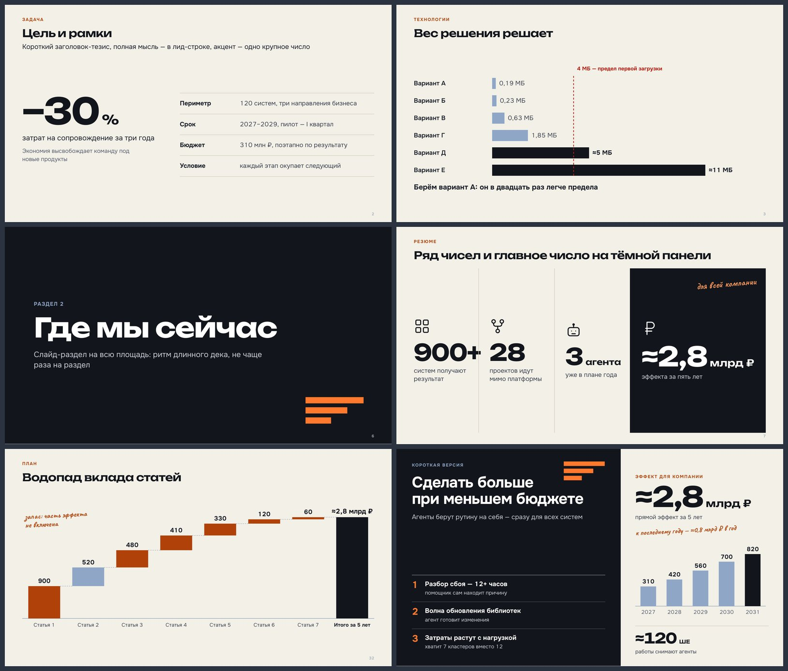
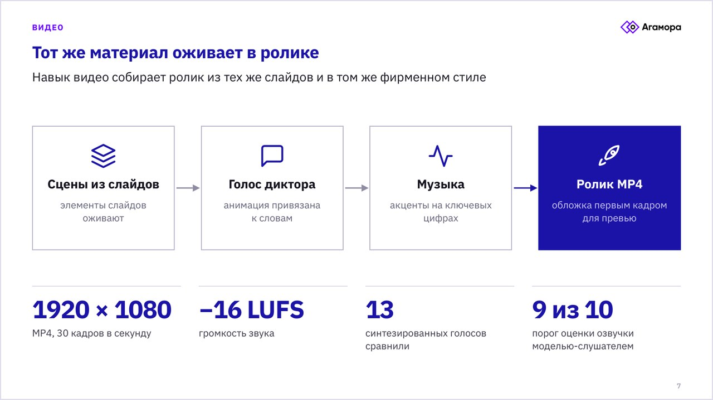
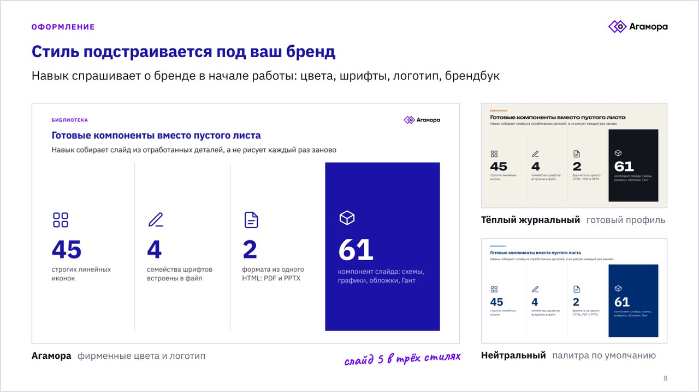

<p align="center">
  <a href="docs/agamora-video-demo.mp4?raw=true" title="Ролик со звуком: MP4, 1 мин 35 с">
    
  </a>
</p>

<h1 align="center">Агамора: презентации и ролики для руководства</h1>

<p align="center">
  Два навыка для <a href="https://claude.com/claude-code">Claude Code</a>. Первый собирает дизайнерскую презентацию
  для руководства: <b>PDF и редактируемый PPTX</b>. Второй превращает её в <b>анимационный ролик с голосом и музыкой</b>.
  Строгий аналитический стиль без признаков «вайбкодинга» и ИИ-слопа, под ваш бренд.
</p>

<p align="center">
  <a href="docs/agamora-video-demo.mp4?raw=true"><b>▶&nbsp;Ролик со звуком</b></a> &nbsp;·&nbsp;
  <a href="docs/agamora-showcase.pdf"><b>Презентация в PDF</b></a> &nbsp;·&nbsp;
  <a href="#установка">Установка</a> &nbsp;·&nbsp;
  <a href="#быстрый-старт">Быстрый старт</a>
</p>

<table>
  <tr>
    <td align="center" width="25%"><h3>85</h3>правил с&nbsp;причинами: каждое однажды вернуло дек</td>
    <td align="center" width="25%"><h3>61</h3>компонент слайда: схемы, графики, Гант, обложки</td>
    <td align="center" width="25%"><h3>PDF&nbsp;·&nbsp;PPTX</h3>из&nbsp;одного HTML с&nbsp;той&nbsp;же геометрией</td>
    <td align="center" width="25%"><h3>1080p</h3>ролик с&nbsp;голосом, музыкой и&nbsp;обложкой</td>
  </tr>
</table>

## Навыки показывают себя сами

Ролик и презентация ниже сделаны самими навыками и рассказывают о них самих. Каждый материал собирается
одной командой из исходника в этом репозитории: его можно пересобрать и сравнить с тем, что показано здесь.

### Ролик

<a href="docs/agamora-video-demo.mp4?raw=true"></a>

**[▶ Скачать ролик со звуком](docs/agamora-video-demo.mp4?raw=true)** · MP4, 3,8 МБ · 1 мин 35 с · 1920 × 1080 · 30 кадров/с · голос ElevenLabs v4 через OpenRouter

Восемь сцен из элементов презентации. Элементы появляются на словах диктора, цифры прокручиваются в момент,
когда о них говорят, удары музыки ложатся на «посадку» цифр, а первый кадр — обложка для превью в мессенджере.
Сценарий — [`scenario.example.js`](skills/agamora-video/scripts/scenario.example.js).

### Презентация

<a href="docs/agamora-showcase.pdf"></a>

**[PDF](docs/agamora-showcase.pdf)** · **[PPTX](docs/agamora-showcase.pptx)** · девять слайдов · генератор
[`examples/showcase.py`](skills/agamora-presentations/examples/showcase.py)

## Навык презентаций

[`skills/agamora-presentations`](skills/agamora-presentations/SKILL.md) делает деки, которые выглядят как работа
дизайнера аналитических презентаций: одна мысль на слайд, короткий заголовок-тезис, один акцент, крупная графика
вместо текста, честные числа.



- **Свод из 85 правил** подачи, языка, чисел, композиции, цвета и форм визуализации — у каждого записана причина
  ([`rules.md`](skills/agamora-presentations/references/rules.md)). Правила выросли из замечаний руководства
  к десяткам деков; журнал опыта из 28 уроков объясняет, почему они такие
  ([`lessons.md`](skills/agamora-presentations/references/lessons.md)).
- **Библиотека `deckkit`** на Python: каркас слайда 1600 × 900, 61 компонент (схемы, графики, приёмы акцентов,
  раскладки, Гант, обложки-иллюстрации) и 45 строгих линейных иконок.
- **Один HTML — два формата:** PDF печатью Chrome и редактируемый PPTX с той же геометрией — родной текст,
  фигуры и кривые, заметки докладчика.
- **Проверка перед сдачей:** кегль от 20 px, вылеты и наложения, контраст по WCAG, заголовок не длиннее двух
  строк, перегруз, сноски и пустые полосы — автоматически; затем листы кадров глазами.
- **Встроенные шрифты** IBM Plex Sans, Onest, Unbounded, Caveat: дек одинаков на Windows и macOS и собирается без сети.

<details><summary><b>Галерея форм подачи</b></summary>






</details>

## Навык видео

[`skills/agamora-video`](skills/agamora-video/SKILL.md) превращает материал в анимационный ролик с закадровым
голосом — ожившие слайды в том же фирменном стиле.



- **Сцены из элементов презентации:** плоские карточки, схемы, строка итогов, счётчики-барабаны; рамки
  прорисовываются, стрелки дорисовываются, между главами — фирменная шторка.
- **Анимация привязана к речи:** границы предложений находятся по паузам в записи, элемент появляется на слове,
  которое его называет.
- **Реалистичный голос** через OpenRouter: из 13 сравнённых женских голосов лучший по русскому произношению —
  ElevenLabs v4 · jessica. Каждый фрагмент слушает модель-оценщик, порог — 9 из 10; ошибки исправляются
  переписыванием фразы.
- **Музыка и звук:** подложка с акцентами на ключевых цифрах, приглушение под речью, голос −16 LUFS.
- **Готово к отправке:** MP4 1920 × 1080, 30 кадров/с, первый кадр — обложка, поэтому превью в мессенджере не пустое.

## Под ваш бренд



Оба навыка начинают с вопроса о фирменном стиле: брендбук или шаблон, логотип, цвета, шрифты, удачные образцы.
Материал затачивается под конкретный бренд, а не штампуется по шаблону. Бренд — один файл `brand.json`:

```json
{
  "name": "Компания",
  "logo": "logo.svg",
  "motif_shape": "bars",
  "fonts": {"text": "IBM Plex Sans", "display": "IBM Plex Sans"},
  "colors": {"primary": "#1C14A8", "accent": "#6B00FF", "light": "#B5A3F5"}
}
```

Бренды заказчиков лежат в `brands-local/` и не попадают в git. В примерах, скриншотах и демонстрациях навыков —
только бренд Агаморы ([`brands/agamora`](skills/agamora-presentations/brands/agamora)): чужая айдентика в материалах
навыков запрещена. Готовые профили: нейтральная палитра по умолчанию, `editorial`, `example`.

## Установка

Как плагин через маркетплейс — ставит оба навыка:

```bash
claude plugin marketplace add agamoraviral/agamora-skill
claude plugin install agamora-presentations@agamora
```

Или вручную — скопировать обе папки рядом в личные навыки Claude Code (навык видео берёт шрифты и бренды
у навыка презентаций):

```bash
git clone https://github.com/agamoraviral/agamora-skill
cp -r agamora-skill/skills/agamora-presentations agamora-skill/skills/agamora-video ~/.claude/skills/
```

Зависимости:
- **презентации** — Python 3.9+, `pip install python-pptx pymupdf pillow`, Chrome, Chromium или Edge
  (путь находится сам, иначе переменная `CHROME_PATH`);
- **ролики** — Node.js 18+, `npm install` в `skills/agamora-video/scripts` (puppeteer-core и ffmpeg-static,
  Chrome — системный), ключ OpenRouter одной строкой в `~/secrets/openrouter.key`; для запросов со звуком на балансе
  нужно не меньше $0,50.

## Быстрый старт

Достаточно попросить Claude: «сделай презентацию для руководства по …» или «сделай ролик по этой презентации».
Навык подключится сам: спросит о бренде, проведёт через бриф, сюжет, форму подачи, сборку, вывод и проверку.

Пересобрать примеры из этого README:

```bash
python skills/agamora-presentations/examples/showcase.py     # презентация → examples/out/
python skills/agamora-presentations/examples/gallery.py      # галерея всех компонентов
cd skills/agamora-video/scripts && npm install
node render_video.js --silent --preview preview    # кадры и проверка вёрстки без синтеза речи
node render_video.js                               # ролик с голосом → agamora-video-demo.mp4
```

## Лицензия

Двойная лицензия на выбор пользователя: [Apache-2.0](LICENSE-APACHE) или [MIT](LICENSE-MIT).
При распространении сохраняйте файл [NOTICE](NOTICE) с указанием автора.
Шрифты в `assets/fonts/` распространяются по SIL Open Font License 1.1 (файлы `OFL.txt` рядом).
Логотип Агаморы принадлежит владельцу и в лицензию кода не входит.

© 2026 [agamoraviral](https://github.com/agamoraviral)
